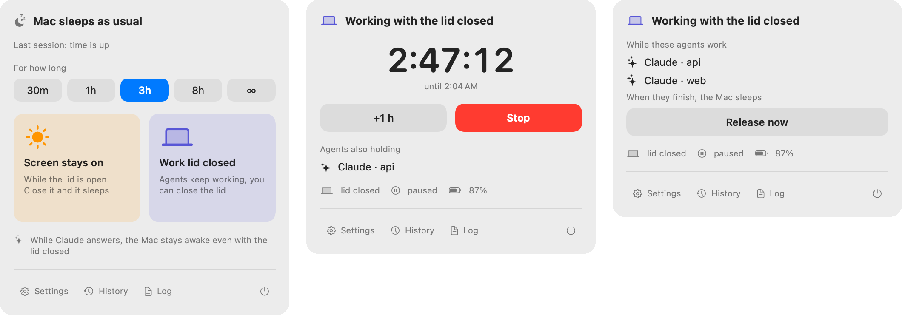

# Awake

Keeps your Mac awake — including with the lid closed — while your agents work.
A menu-bar panel for you, plus an `awake` CLI that scripts and agents can drive.

Tested on macOS 15.7, Apple Silicon. English and Russian UI (follows the system language; override in settings).

<p align="center">
  <picture>
    <source media="(prefers-color-scheme: dark)" srcset="docs/panel-dark.png">
    
  </picture>
  <br>
  <sub>Idle · a timed lid session · Claude sessions holding the Mac awake</sub>
</p>

## Modes

| | What it does | How |
|---|---|---|
| **Screen stays on** (`on`) | The Mac doesn't sleep while the lid is open. Close it and it sleeps as usual. A replacement for KeepingYouAwake / `caffeinate -di`. | IOPM assertions |
| **Work with the lid closed** (`lid`) | The Mac keeps running with the lid shut: display off, audio muted, chosen apps paused. Always has an end time. | `pmset disablesleep 1` via a sudoers rule |

While Claude Code is answering, Awake holds *lid* mode on its own: close the lid and the agent finishes; once it's done, the Mac sleeps.

A session ends by itself when its timer runs out, on battery below a floor (15% by default), or when the Mac overheats (`critical` always, `serious` only with the lid closed).

## Install

Requires Xcode (Swift 6).

```bash
git clone git@github.com:merely04/awake.git ~/dev/awake
cd ~/dev/awake
./scripts/install.sh
```

The script builds `~/Applications/Awake.app`, links `~/.local/bin/awake`, and installs two LaunchAgents: the app itself (starts at login, restarted if it crashes) and a `backstop` safety net.

*Work with the lid closed* needs a sudoers rule. The script prints a `sudo install …` command — run it once. The rule allows exactly two commands without a password:

```
<user> ALL=(root) NOPASSWD: /usr/bin/pmset -a disablesleep 0, /usr/bin/pmset -a disablesleep 1
```

Any program running as your user can use it; the worst it can do is keep the Mac from sleeping.

Update by running `./scripts/install.sh` again. Uninstall with `./scripts/uninstall.sh` (settings and logs are kept).

## Panel

Click the menu-bar icon (or press ⌃⌥⌘A), pick a duration, tap a mode tile. During a session you get a countdown, **+1 h**, **Stop**, and the list of agents holding the Mac awake. Settings, history and the log are at the bottom.

⌃⌥⌘L toggles *work with the lid closed* for the duration selected in the panel (∞ falls back to 3 h).

## CLI

```
awake [status] [--json]   current state
awake on [DUR]            screen stays on (no DUR = until turned off)
awake lid DUR             work with the lid closed
awake add DUR             extend the session
awake off                 stop the session
awake history [N]         recent sessions

awake run [--awake] [DUR] -- CMD...   stay awake while CMD runs; exits with CMD's code
awake hold [--awake] [--pid PID] [--id ID] [--label TEXT] [DUR]
awake release [--id ID | --pid PID | --all]
```

`DUR`: `90` (minutes), `45m`, `2h`, `1h30m`, `1d`.

Holds (`run`, `hold`) last as long as their process and disappear when it exits. Battery and heat guards silence them but don't remove them.

## Claude Code

Add these hooks to `~/.claude/settings.json` next to any you already have (`install.sh` doesn't touch it):

```json
{
  "hooks": {
    "UserPromptSubmit": [{ "hooks": [{ "type": "command", "timeout": 5,
      "command": "[ -x \"$HOME/.local/bin/awake\" ] && \"$HOME/.local/bin/awake\" hold --claude >/dev/null 2>&1; exit 0" }] }],
    "Stop":        [{ "hooks": [{ "type": "command", "timeout": 5,
      "command": "[ -x \"$HOME/.local/bin/awake\" ] && \"$HOME/.local/bin/awake\" release --claude >/dev/null 2>&1; exit 0" }] }],
    "StopFailure": [{ "hooks": [{ "type": "command", "timeout": 5,
      "command": "[ -x \"$HOME/.local/bin/awake\" ] && \"$HOME/.local/bin/awake\" release --claude >/dev/null 2>&1; exit 0" }] }],
    "SessionEnd":  [{ "hooks": [{ "type": "command", "timeout": 5,
      "command": "[ -x \"$HOME/.local/bin/awake\" ] && \"$HOME/.local/bin/awake\" release --claude >/dev/null 2>&1; exit 0" }] }]
  }
}
```

`hold --claude` reads the hook JSON from stdin, finds the Claude process among its ancestors, and prints nothing (`UserPromptSubmit` output would land in the model's context). If Claude dies before `Stop`, the hold goes away with the process. Pick the agent mode (nothing / screen / lid closed) in the panel's settings.

## Notifications

- **Phone, via [ntfy](https://ntfy.sh).** Install the ntfy app and subscribe to the topic shown in settings (`awake-…`, randomly generated). You get: session ended, agent finished with the lid closed, Mac is getting hot, battery or heat switched off an agent's protection, hotspot events.
- **On the Mac** — the same, plus "10 minutes left" with a **+1 h** button (for sessions longer than 15 minutes). The app is ad-hoc signed and UserNotifications refuses those, so it falls back to the deprecated `NSUserNotificationCenter`.

## While the lid is closed

In *work with the lid closed* mode:

- the display turns off (`pmset displaysleepnow`);
- audio is muted and the keyboard backlight goes dark, both restored on open (the backlight uses the private `KeyboardBrightnessClient`; if a future macOS drops it, that step is skipped);
- apps on the list (Telegram by default) get `SIGSTOP`, then `SIGCONT` when the lid opens;
- if Wi-Fi has no connection for 60 s, Awake joins your iPhone hotspot. Set the network name in settings; the Mac must already know that network, because Awake never stores or passes the password — macOS supplies it. Only the Wi-Fi interface is watched, so a dead VPN won't make it switch networks.

## Reliability

- Every second the engine reconciles `session.json` and the holds with the system and writes `status.json`.
- If the app crashes, launchd restarts it; on launch it unfreezes processes and restores audio and the backlight.
- If the app is dead, `backstop.sh` runs every minute: sets `disablesleep 0`, unfreezes processes from `frozen.pids`, unmutes audio.
- On quit and on `SIGTERM` everything is undone — lid actions first, then sleep is allowed again.

## Files

| | |
|---|---|
| `~/Library/Application Support/Awake/config.json` | settings: battery floor, apps to pause, agent mode, audio, backlight, ntfy, hotspot |
| `session.json`, `holds.json`, `status.json` | desired session, holds, actual state |
| `history.jsonl` | session history |
| `frozen.pids`, `lidstate.json` | what the lid close changed — to undo it after a crash |
| `~/Library/Logs/Awake/awake.log` | who started what, sleep/wake, a heartbeat every 5 min (a gap means the Mac slept), battery, temperature, frozen pids; rotates at 2 MB into `awake.log.1` |
| `~/Library/Logs/Awake/stderr.log` | process output if it crashes |

## Development

```bash
swift build
swift test
```

Every decision about timers, battery, heat, the lid and holds is one pure function, `makePlan` in `Sources/AwakeCore`, and that's what the tests cover. Everything that touches the system lives in `Sources/Awake`.

## License

[MIT](LICENSE)
